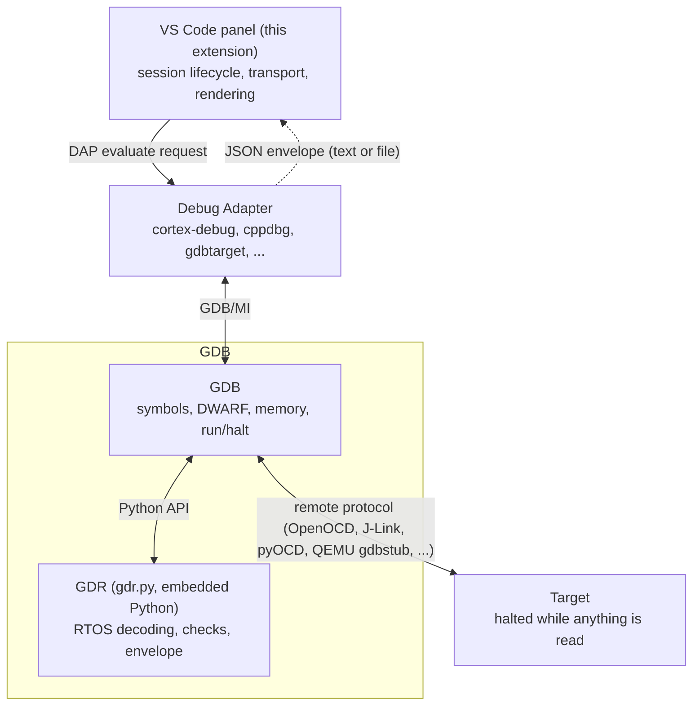

# GDB RTOS Views

An RTOS view for embedded debugging, driven by [GDR (GDB enhance for RTOS)](https://github.com/flespark/gdr) CLI.
For discover task/timer/IPC/heap status, resource usage, corruption and potential bug.


## How it works

### Layers

Four layers sit between the panel and the target. Each one does one job, and
only GDR knows anything about the RTOS:

The data flow is: VS Code panel → debug adapter → GDB/GDR → halted target;
GDR returns a versioned JSON envelope through GDB, and the panel renders that
response.



- **GDB** is the debugger itself. It owns the connection to the target, the
  ELF symbols and DWARF types, memory reads, and run/halt control. It also
  hosts the Python interpreter that GDR runs in, which is why the session's
  GDB must be built with Python.
- **The debug adapter** is the extension you already debug with (see
  [Supported debug adapters](#supported-debug-adapters)). It starts GDB,
  translates VS Code's Debug Adapter Protocol (DAP) into GDB/MI commands, and
  drives continue/step/breakpoints. This extension does not replace it. It
  only adds the GDR loader to the adapter's launch-time command hooks, and it
  asks questions through the adapter's DAP `evaluate` request, the same path
  a watch expression takes. The adapter's stop and run events reach the
  extension through the [tracker extension](#why-the-tracker-extension-depends).
- **GDR** could be used as a independent CLI (`source gdr.py` at the GDB
  prompt). It is the only layer that understands kernel structures: it walks
  the RTOS's task lists, objects and heap through GDB, checks them for
  consistency, and returns the result as a versioned JSON envelope through
  the `$gdr_json` convenience function. The text commands and the envelope are
  built from the same collectors, so a view can never disagree with what a
  command such as `rtt threads` prints at the GDB prompt.
- **This extension** is a client of that envelope. It runs the session
  lifecycle (check Python, load GDR, probe, initialize), carries the envelope
  back (inline `evaluate` results reassembled from chunks, or a temporary file
  when the adapter cannot return the payload), refuses a bundled runtime
  whose envelope schema it was not built for, and renders the result in the
  panel. It decodes no kernel structure and reads no target memory of its
  own; everything it shows comes from a field GDR returned.

### Session lifecycle

1. **At launch** it checks that GDB has Python, then `source`s the bundled
   `gdr.py`. Without Python the session still starts; an error notification explains why GDR could not start.
2. **At the first stop** it asks GDR which RTOS and version this target is
   (`$gdr_json("probe")`) and initializes that adapter.
3. **At every later stop** the panel asks for one snapshot, which runs the
   same collectors as the commands at the GDB prompt.

### Stop snapshot

Nothing is read while the target runs: GDR answers only at a stop, and the
extension marks the snapshot on screen as stale as soon as the target
resumes. Neither GDR nor the extension writes target memory or calls a
function in the firmware (a GDB inferior call), because an inferior call
resumes the target and could change the very state the snapshot is meant to
capture. Running the target stays entirely under the firmware's and your
control.

## Supported RTOS

See [GDR readme](https://github.com/flespark/gdr#readme)

## Supported debug adapters

GDR is loaded into the session's own GDB through the launch key that adapter
actually reads, so the key is listed per adapter rather than assumed.

| Adapter | Loader injection | GDB binary setting | Verification |
| --- | --- | --- | --- |
| `cortex-debug` | `postLaunchCommands` / `postAttachCommands` | `gdbPath` | verified on real targets |
| `cppdbg` | `setupCommands` (Eclipse-style entries) | `miDebuggerPath` | verified on real targets |
| `stlinkgdbtarget` (STM32Cube ST-LINK GDB Server) | `initCommands` | `gdb` | extension path and adapter contract verified in VS Code against a QEMU target; ST's device lookup, ST-LINK_gdbserver and a real probe are not exercised |
| `gdbtarget` | `initCommands` | `gdb` | mapped from the adapter's own documentation, not yet exercised |
| `jlinkgdbtarget` | `setupCommands` | `gdb` | not verified |
| `probe-rs-debug`, `cspy` | — | — | refused in the panel: no GDB console to host GDR. Use a GDB-backed adapter against the same target's GDB server |

A session GDR cannot host still gets a tab stating that reason, instead of
failing later with an empty panel.

The session's GDB must have Python. xPack ships both variants:
`arm-none-eabi-gdb` has none, `arm-none-eabi-gdb-py3` does — point the adapter's
GDB setting (the third column above) at the `-py3` binary. The extension names
the setting to use instead of showing an empty panel.

## Why the tracker extension depends

`mcu-debug.debug-tracker-vscode` is a declared `extensionDependencies` entry,
because VS Code's own debug API exposes neither the adapter's stopped/running
events nor the stack frame it stopped in. The plugin subscribes to the tracker's
v1 API for exactly four things:

- `started` — the session gets its tab before GDR has answered anything;
- `first-stack-trace` — the stop, carrying the frame id every `evaluate` read
  needs, which is what makes the panel refresh per stop instead of per poll;
- `running` — the snapshot on screen is marked stale instead of refreshed;
- `terminated` — the launch's temporary scripts are removed, the tab closes.

Every other event the tracker sends (`capabilities`, `protocol-event`,
`initializing`) is ignored. GDR itself is never driven while the target runs, so
a tracker that is missing or answers with a shape this client does not know
produces a startup error notification rather than silently leaving the panel
without data or reading a moving target.

## The GDR panel

The **GDR** panel appears there once a debug session GDR can drive starts, and
stays out of the way otherwise (no standing activity-bar icon).
`GDR: Open RTOS Views` focuses it from the Command Palette; the refresh button
in its title bar re-reads the target on demand. Startup failures are reported
even before the
webview is opened: runtime/Python/transport failures are errors, while missing
RTOS/version selection or an unsupported adapter is a warning. Notifications
include the session name and cause, with repeated causes suppressed per session;
details remain in the Output Channel and Debug Console.

One tab per debug session. Each tab shows the snapshot GDR took at the last
stop, in this order:

- **System**: one header row and one value row, the same shape as the task
  table. It shows the current task, the tick, the scheduler state (`Unlocked`,
  `Locked (nest N)` or `In ISR (nest N)`, omitted when the target cannot read
  it). Per-kind object counts and the heap used/total/status fields are omitted;
  heap counters live in the Heap card.
- **Tables**: one card per object kind (tasks, timers, heap, semaphores, mutexes,
  events, mailboxes, message queues, memory pools). Numeric columns are
  right-aligned, stack usage is a bar, waiters collapse, and addresses are
  clickable. Diagnostic columns are the consistency checks of that kind.
- **Heap**: the basics in one header row and one value row, with the heap's
  consistency checks as diagnostic columns. There is no separate Checks card.
  *Draw heap map* draws the block layout on a canvas: free blocks are grey, each
  owner has a colour, and hovering a block reads `owner:<name>, size: <n> B`.
  The collapsible map refreshes at each stop once you have asked for it;
  block details appear only in the floating pointer tooltip.
- **Hint bars**: the warnings and capability gaps GDR reports, verbatim.

The **Display selection** list above the cards ticks which tables and which
columns are drawn. A table whose data is missing (no heap, a kind the target
cannot enumerate) is greyed out. Each table's column group starts collapsed;
checkbox changes keep the groups open and preserve the current scroll position.
Drag a card's title to change the table order, drag a column header to reorder
columns, and drag its edge to resize it. Checkbox parents and children follow the
same table/column order, including hidden columns in their saved positions.
Drag a parent row in Display selection to reorder tables, or a child column
chip to reorder that table's columns; hidden tables and columns can also be
reordered without enabling them. Heap basics and checks reorder within their
respective tables. Drag handles, drop outlines and diagnostic badges distinguish
reordering from checkbox selection. The layout is saved per workspace.

A value that changed since the previous stop is drawn in the theme's number
colour, so a changed value is distinct from a link. The first stop has nothing to
compare with and shows no change.

## Settings

| Setting | Meaning |
| --- | --- |
| `gdr.runtimePath` | GDR CLI entry directory holding `gdr.py`. Empty uses the bundled copy; set it to run against a development checkout. |
| `gdr.rtos` / `gdr.version` | Initialize exactly this adapter and version, overriding the probe. A manual setting is treated as the user's assertion: it registers with GDR's `--allow-unverified`, so a modified or stripped kernel still works, and the panel then shows a hint saying the target could not confirm it. |
| `gdr.autoInit` | Initialize automatically when the probe is unambiguous (default). Turn it off to always be asked. |
| `gdr.refreshOnStop` | Refresh the panel at each stop (default on). Turn off to refresh only on initialization or with the panel's refresh button. |
| `gdr.refreshHeaps` | Include the heap snapshot in every refresh (default on). The heap walk is the most expensive part; turn off when stops feel slow. |
| `gdr.refreshDetails` | Include the per-kind detail tables in every refresh (default on). Each one walks its objects' entries; turn off when stops feel slow. |
| `gdr.recordSnapshotsDir` | Directory to save snapshot JSON files on each refresh (for offline inspection and bug reports). Empty disables recording (default). |
| `gdr.snapshotTransport` | Transport method for snapshots from GDB to the extension: `evaluate` (default) transfers data in memory via DAP; `file` passes data via temporary files (faster for large snapshots, but requires GDB and VS Code to share a filesystem). GDR switches to `file` by itself when the adapter's `evaluate` cannot carry a payload (cortex-debug and the cdt-gdb family, ST-LINK included, render a returned string as its element count, so those sessions use the file route). |

The probe answers with its evidence and its confidence (`exact`, `range`,
`undetected`); the extension initializes automatically only for an
unambiguous exact result, and otherwise asks — with the evidence attached. A
resolved answer is cached per launch configuration, so a reflash in place does
not ask again.

## Versioning

The extension version tracks GDR's own year.serial release (the `__version__` in
`gdr/__init__.py`), with the semver patch left free for extension-only fixes:
GDR `2026.4` ships as extension `2026.4.0`, and a packaging or UI fix may
publish `2026.4.1` against the same runtime. `ci/check-vendored-schema.py` fails
when the two disagree, so a bundle never claims a runtime it was not built
from.

## Development

```bash
npm install
npm run vendor        # generate resources/gdr from this repository's runtime
npm run check-types
npm test              # units, plus a real QEMU/GDB session check when fixtures exist
npm run build         # emit dist/extension.js
npm run package       # vendor + build + gdb-rtos-views.vsix (installable)
```

`resources/gdr` is generated and ignored by git; `src/runtime.ts` refuses to
run when the bundled manifest's envelope schema differs from the schema this
client was built for, so an old extension never mis-renders a newer GDR.

## Shipping

`npm run package` produces `gdb-rtos-views.vsix` (the vendored GDR runtime and
the compiled client included). CI builds the same VSIX on every push and keeps
it as a build artifact / commit attachment **for verification only**: a
maintainer compares it with a local build and then publishes to the Marketplace
by hand. CI never publishes, because Marketplace versions are immutable and the
credentials would be a leak in the open-lane config.

`ci/check-vendored-schema.py` checks the generated bundle's version and schema
against the source checkout, and enforces the version rule
(`GDR x.y` ships as extension `x.y.0`).

## Known limits

- The file route needs the extension to read the filesystem GDB writes to. GDR
  picks that route by itself when `evaluate` cannot carry a payload (every
  Cortex-Debug or ST-LINK session, see the `gdr.snapshotTransport` row above), so a GDB in
  a separate filesystem namespace (for example WSL) cannot use Cortex-Debug at
  all; the panel reports the failed bypass instead of showing nothing.
- The probe reads versions from DWARF. A build without `-g3` exports no version
  macro, so the extension asks the user instead of guessing.
