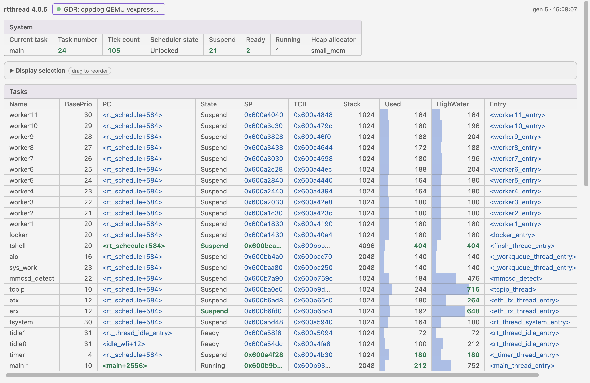
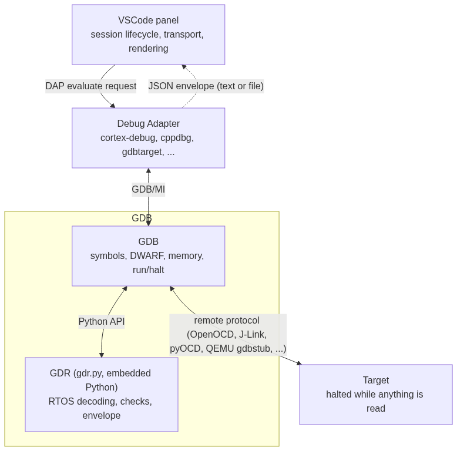

# GDB RTOS Views

An RTOS view for embedded debugging, driven by [GDR (GDB enhance for RTOS)](https://github.com/flespark/gdr).
Discovers task/timer/IPC/heap status, resource usage, corruption and potential bugs.



## How it works

Four layers sit between the panel and the target; only GDR knows anything
about the RTOS. The data flow is: VS Code panel → debug adapter → GDB/GDR →
halted target. GDR returns a versioned JSON envelope through GDB (see
`docs/architecture.md` for the envelope contract), and the panel renders it.

<!-- Layers diagram: source is vscode/media/architecture.mmd; re-render with
     mermaid.ink `/img` (type=png, bgColor=FFFFFF) before editing this file. -->


- **GDB** owns the target connection, symbols, memory reads, and run/halt
  control, and hosts the Python interpreter GDR runs in (the session's GDB
  must be built with Python).
- **The debug adapter** (see [Supported debug adapters](#supported-debug-adapters))
  starts GDB and drives continue/step/breakpoints. This extension only adds
  the GDR loader to its launch-time hooks and asks questions through DAP
  `evaluate`, the same path a watch expression takes. Stop/run events arrive
  through the [tracker extension](#why-the-tracker-extension-depends).
- **GDR** (usable standalone via `source gdr.py`) walks task lists, objects
  and heap, checks consistency, and returns one JSON envelope per stop.
  Text commands and the envelope share collectors, so a view never disagrees
  with `rtt threads` at the GDB prompt. Nothing is read while the target
  runs, and neither layer writes target memory or calls firmware functions.
- **This extension** runs the session lifecycle (check Python, load GDR,
  probe, initialize), carries the envelope back (inline `evaluate` or a
  temporary file when the adapter cannot return the payload), refuses a
  bundled runtime whose envelope schema it was not built for, and renders
  the panel. It decodes no kernel structure of its own.

The probe answers with evidence and confidence (`exact`, `range`,
`undetected`); the extension auto-initializes only on an unambiguous exact
result, otherwise asks with the evidence attached. A resolved answer is
cached per launch configuration.

## Supported RTOS

See [GDR readme](https://github.com/flespark/gdr#readme)

## Supported debug adapters

GDR is loaded into the session's own GDB through the launch key that adapter
actually reads, so the key is listed per adapter rather than assumed.

| Adapter | Loader injection | GDB binary setting | Verification |
| --- | --- | --- | --- |
| `cortex-debug` | `postLaunchCommands` / `postAttachCommands` | `gdbPath` | verified on real targets |
| `cppdbg` | `setupCommands` (Eclipse-style entries) | `miDebuggerPath` | verified on real targets |
| `stlinkgdbtarget` (STM32Cube ST-LINK GDB Server) | `initCommands` | `gdb` | extension path and adapter contract verified against a QEMU target; ST device lookup and a real probe are not exercised |
| `gdbtarget` | `initCommands` | `gdb` | mapped from the adapter's documentation, not yet exercised |
| `jlinkgdbtarget` | `setupCommands` | `gdb` | not verified |
| `probe-rs-debug`, `cspy` | — | — | refused: no GDB console to host GDR |

A session GDR cannot host gets a tab stating that reason. The session's GDB
must have Python (xPack: use the `-py3` binary, e.g. `arm-none-eabi-gdb-py3`).

## Why the tracker extension depends

`mcu-debug.debug-tracker-vscode` is a declared `extensionDependencies` entry,
because VS Code's own debug API exposes neither the adapter's stopped/running
events nor the stopped stack frame. The plugin subscribes for `started` (open
the tab), `first-stack-trace` (refresh per stop, not per poll), `running`
(mark the snapshot stale), and `terminated` (clean up and close). A missing or
unrecognized tracker produces a startup error rather than a silently empty
panel.

## The GDR panel

One tab per debug session, showing the snapshot from the last stop: a System
row (current task, tick, scheduler state), one card per object kind (tasks,
timers, heap, IPC kinds with their consistency verdicts as diagnostic
columns), the heap card with an optional block-occupancy map, and hint bars
for GDR's warnings and build advice.

The **Display selection** list ticks which tables and columns are drawn;
missing tables grey out. Cards and columns reorder by drag and resize by edge;
the layout is saved per workspace. Values changed since the previous stop
render in the theme's number colour.

## Settings

| Setting | Meaning |
| --- | --- |
| `gdr.runtimePath` | GDR entry directory holding `gdr.py`. Empty uses the bundled copy; set it to run a development checkout. |
| `gdr.rtos` / `gdr.version` | Initialize exactly this adapter and version, overriding the probe (registered `--allow-unverified`, with the caveat shown as a hint). |
| `gdr.autoInit` | Initialize automatically when the probe is unambiguous (default). |
| `gdr.refreshOnStop` | Refresh the panel at each stop (default on). |
| `gdr.refreshHeaps` | Include the heap snapshot in every refresh (default on; the most expensive walk). |
| `gdr.refreshDetails` | Include per-kind detail tables in every refresh (default on). |
| `gdr.recordSnapshotsDir` | Save snapshot JSON files on each refresh for offline inspection (default empty/disabled). |
| `gdr.snapshotTransport` | `evaluate` (default) or `file` for very large payloads; GDR switches to `file` by itself when the adapter's `evaluate` cannot carry a payload. |

## Development and shipping

```bash
npm install
npm run vendor        # generate resources/gdr from this repository's runtime
npm run check-types
npm test              # units, plus a real QEMU/GDB session check when fixtures exist
npm run build         # emit dist/extension.js
npm run package       # vendor + build + gdb-rtos-views.vsix (installable)
```

`resources/gdr` is generated and ignored by git; `src/runtime.ts` refuses to
run when the bundled manifest's envelope schema differs from the schema this
client was built for. `npm run package` produces the installable VSIX; CI
builds the same VSIX on every push for verification only and never publishes
(Marketplace releases are published by hand). `vscode/scripts/check-vendored-schema.py`
checks the bundle's version and schema against the source checkout
(`GDR x.y` ships as extension `x.y.0`).

The real-session tests consume firmware under `ci/.cache/fixtures/` and
registered tools from `ci/.cache/tools/<host>/bin/`, with PATH fallback.
Prepare `rtthread/cortex-a9/4.0.5` (and the optional ST adapter lane's
`freertos/mps2-an385/11.1.0/base`) with the
[shared CLI](../ci/README.md). Missing requirements are reported as skips;
ST adapter configuration uses the explicit `GDR_STLINK_*` test settings.

## Known limits

- The file route needs the extension to read the filesystem GDB writes to, so
  a GDB in a separate filesystem namespace (for example WSL) cannot use
  Cortex-Debug; the panel reports the failed bypass instead of showing nothing.
- The probe reads versions from DWARF. A build without `-g3` exports no version
  macro, so the extension asks the user instead of guessing.
